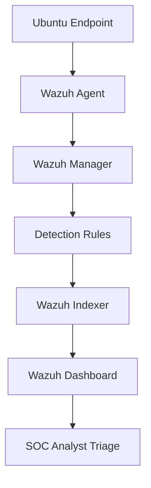
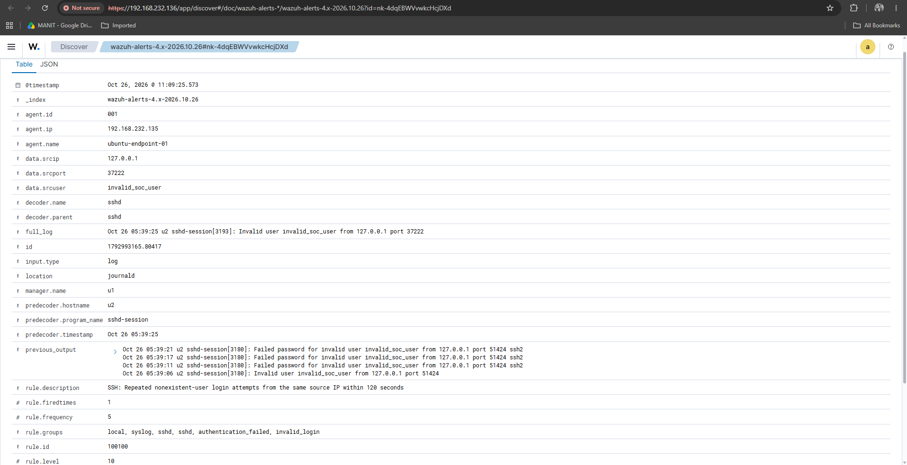
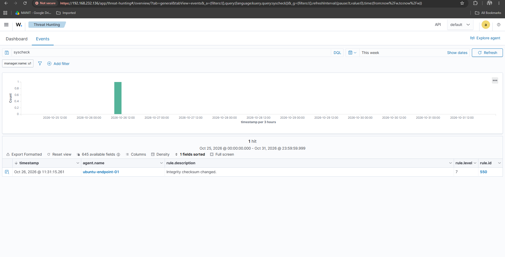
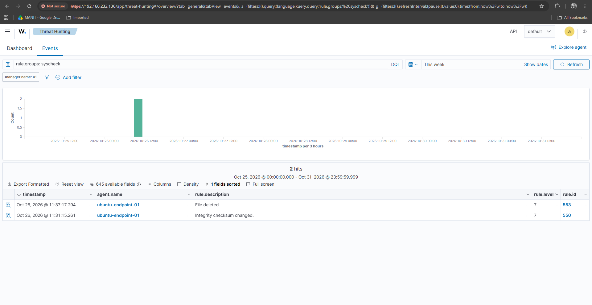

# Enterprise SOC Threat Detection Lab — Wazuh

A hands-on Security Operations Center (SOC) lab demonstrating endpoint monitoring, custom detection engineering, File Integrity Monitoring (FIM), alert validation, and L1 analyst triage using Wazuh.

## Project Overview

This project simulates selected security monitoring scenarios in a controlled Ubuntu environment. It demonstrates how endpoint events are collected, evaluated against detection rules, displayed as SIEM alerts, and reviewed using a structured analyst workflow.

**Environment:** Wazuh 4.14.9, Ubuntu endpoint, Wazuh Manager, Wazuh Indexer, and Wazuh Dashboard.

## Validated Detection Results

| Use case | Wazuh rule | Severity | Result |
|---|---|---|---|
| Repeated SSH authentication failures | `100100` — custom | Level 10 | Triggered during controlled testing |
| File modification | `550` | Level 7 | Alert verified |
| File deletion | `553` | Level 7 | Alert verified |

The custom SSH rule correlates five matching events from the same source IP within 120 seconds. During the test, the source IP was `127.0.0.1` and the username was `invalid_soc_user`. This was a local lab simulation, not evidence of an external attack.

## Architecture

## Evidence

The screenshots below should be stored in the repository's evidence folder. Adjust these paths to match the filenames you actually uploaded.

### SSH Authentication Detection

Custom rule `100100` generated a Level 10 alert during the controlled authentication-failure test.

### File Integrity Monitoring — Modification

Rule `550` reported an integrity checksum change in the monitored test directory.

### File Integrity Monitoring — Deletion

Rule `553` reported file deletion in the monitored test directory.

## Documentation

- [Architecture and data flow](docs/architecture.md)
- [SSH detection incident report](docs/incident-report-ssh.md)
- [File Integrity Monitoring incident report](docs/incident-report-fim.md)
- [SOC Analyst L1 triage playbook](docs/triage-playbook.md)
- [Detection validation matrix](docs/validation-matrix.md)
- [Custom SSH detection rule](rules/local_rules.xml)

## Key Skills Demonstrated

- Wazuh SIEM monitoring and service-health checks
- Ubuntu endpoint agent configuration
- Custom XML detection-rule configuration
- Authentication-failure correlation
- File Integrity Monitoring
- Alert investigation and evidence documentation
- MITRE ATT&CK technique mapping
- SOC L1 triage and escalation workflow

## Scope and Limitations

This project validates selected detection scenarios in a controlled learning environment. It does not claim comprehensive detection coverage, successful attacker compromise, automated containment, or production-grade incident response.

The observed SSH test source was local (`127.0.0.1`). Alert severity alone is not proof of malicious activity; analyst review and event correlation remain necessary.

## Reproduction Notes

1. Deploy Wazuh Manager, Indexer, Dashboard, and an enrolled Ubuntu agent in an isolated lab.
2. Configure and validate the custom SSH correlation rule in the appropriate Wazuh rules configuration.
3. Enable FIM monitoring for a dedicated test directory.
4. Generate controlled authentication-failure, file-modification, and file-deletion events.
5. Review the resulting alerts in Wazuh Dashboard.
6. Document observations, limitations, and relevant evidence.

Validate custom rules against the installed Wazuh version before reuse. Do not expose management interfaces to the public internet or commit credentials and secrets.

## Author

Rahul Saxena
