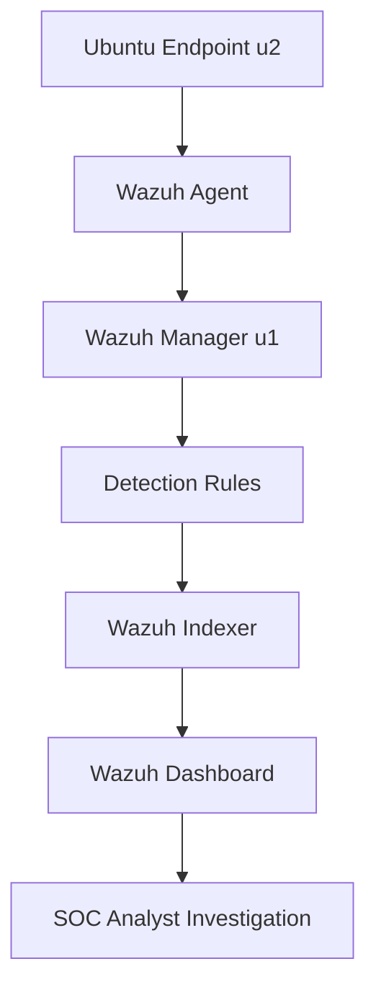

# Wazuh SOC Lab Architecture

## 1. Project Overview

This project demonstrates a hands-on Security Operations Center (SOC) monitoring lab using Wazuh. The lab focuses on endpoint log monitoring, custom authentication detection, File Integrity Monitoring (FIM), alert validation, and basic incident triage.

The objective is to demonstrate the workflow from endpoint telemetry collection to SIEM alert generation and analyst investigation.

## 2. Lab Components

| Component | Role |
|---|---|
| Wazuh Manager (`u1`) | Receives and analyzes endpoint security events and evaluates detection rules |
| Wazuh Indexer | Stores and indexes security event data |
| Wazuh Dashboard | Provides a graphical interface for alert review and investigation |
| Ubuntu Endpoint (`u2`) | Generates authentication and file-integrity telemetry |
| Wazuh Agent | Collects endpoint events and forwards them to the manager |

## 3. Architecture Diagram

## 4. Detection Use Cases

### Use Case 1: Repeated SSH Authentication Failures

A custom Wazuh correlation rule was created to detect repeated SSH authentication failures associated with the same source IP address.

- Custom rule ID: `100100`
- Severity level: `10`
- Frequency threshold: `5`
- Correlation window: `120` seconds
- MITRE ATT&CK mapping: `T1110.001` — Password Guessing
- Validation: The custom rule triggered during controlled testing with repeated matching authentication-failure events.

The lab validation demonstrated rule triggering. It does not establish that a real external attacker compromised or targeted the environment.

### Use Case 2: File Modification Detection

File Integrity Monitoring was configured for the dedicated lab directory:

`/var/ossec/fim-test`

The directory was monitored with `check_all="yes"` and `realtime="yes"`.

- Observed Wazuh rule ID: `550`
- Alert description: Integrity checksum changed
- Validation: Modifying the test file generated a corresponding alert.

### Use Case 3: File Deletion Detection

The same monitored directory was used to validate file deletion monitoring.

- Observed Wazuh rule ID: `553`
- Alert description: File deleted
- Validation: Deleting the test file generated a corresponding alert.

## 5. Data Flow

1. The Ubuntu endpoint generates authentication or filesystem activity.
2. The Wazuh agent collects relevant endpoint telemetry.
3. The Wazuh manager evaluates incoming events against its detection rules.
4. Matching events generate alerts with associated rule IDs and severity levels.
5. The Wazuh indexer stores searchable event data.
6. The Wazuh dashboard displays the alerts for analyst review.
7. The analyst validates the event context, determines its significance, and documents findings and recommended actions.

## 6. Validation Summary

| Test | Expected result | Observed result |
|---|---|---|
| Repeated SSH authentication failures | Custom rule `100100` triggers | Verified |
| Modify monitored test file | FIM rule `550` triggers | Verified |
| Delete monitored test file | FIM rule `553` triggers | Verified |
| Check Wazuh services | Manager, indexer, and dashboard are active | Active when checked |

## 7. Scope and Limitations

This is a controlled learning environment, not a production SOC deployment.

- The SSH scenario validates a custom detection rule using controlled authentication-failure events.
- The observed source IP during the SSH test was `127.0.0.1`; this represents a local test context, not evidence of a remote attacker.
- The FIM tests cover modification and deletion in a dedicated test directory.
- The validation does not establish detection coverage for every SSH attack pattern or filesystem event.
- No successful compromise, automated containment, or production incident response capability is claimed.

## 8. Security Considerations

- Do not commit passwords, API keys, authentication tokens, or private certificates.
- Sanitize screenshots before publishing them.
- Avoid exposing the Wazuh dashboard or management services directly to the public internet.
- Keep custom rules scoped to the intended detection scenario and validate them before deployment.

## 9. Skills Demonstrated

- SIEM deployment and service-health checks
- Endpoint agent monitoring
- Wazuh custom detection-rule configuration
- Authentication-event correlation
- File Integrity Monitoring
- Alert validation and investigation
- MITRE ATT&CK technique mapping
- Security documentation and evidence handling
